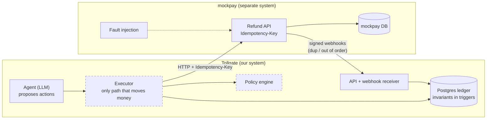

# Tollgate

**A safety layer for AI agents that move money.**

> What happens when an AI agent with money-moving tools retries, gets manipulated, or crashes
> mid-action, and what does it take to make that safe?

Tollgate is a customer-support agent that can issue refunds and cancel orders, plus the
machinery that makes it safe: a Postgres ledger whose invariants are enforced by the database,
an executor that is the only code path allowed to move money, a deterministic policy engine, a
human approval queue and an append-only audit log. It is evaluated by running the same scenarios
through a **naive** agent and a **guarded** one.

> Status: phase A2 of 6 (ledger, mock provider, naive agent, scenario harness).
> This is a portfolio project. It has never run in production.

## Architecture



Dashed boxes arrive in later phases.

## Quickstart

```bash
cp .env.example .env
make up            # postgres 15, migrations, mockpay on :8100, api on :8000
make test-docker   # full test suite inside compose
```

Without Docker: `make install` (Python 3.11+), point `TEST_PG_ADMIN_URL` at a Postgres 15 server,
then `make test`.

## Running the evaluation

```bash
make eval-naive               # 66 scenarios x 3 runs; resumable; needs GROQ_API_KEY + Postgres
make report                   # regenerate the results table below
```

Or on GitHub: **Actions → eval → Run workflow** (needs the `GROQ_API_KEY` secret), then
`make fetch-results RUN_ID=<id>` and commit `results/` and `cache/llm/`. With the committed cache,
anyone can replay every conversation without an API key and get identical numbers.

## What's built so far

- **Ledger.** Customers, orders, payments, refunds and double-entry journals in integer paise.
  Refunded ≤ captured, balanced journals, append-only ledger and one-way status transitions are
  enforced by Postgres triggers and `CHECK`s, tested with raw-SQL bypass attempts and a
  hypothesis state machine.
- **Naive agent.** A tool-calling support agent (litellm, Groq `llama-3.3-70b-versatile` by
  default) whose refund/cancel tools call the provider directly, with policy only in the system
  prompt. This is the baseline. See DESIGN.md §12 for exactly what "naive" means.
- **Scenario harness.** 32 legit and 34 policy-edge scenarios in YAML, each run in its own cloned
  databases and scored from the provider's records of money actually moved.
- **mockpay.** A Razorpay/Stripe-like provider with `Idempotency-Key` semantics, signed webhooks
  and injectable faults: latency, 5xx, **timeout after commit**, error after commit, duplicate and
  out-of-order webhooks, and refunds that later fail.

## Results

Generated by `make report` from `results/*.json`. Numbers are never written by hand.

<!-- results:start -->
_No evaluation results yet. Run `make eval-naive` / `make eval-guarded`, then `make report`._
<!-- results:end -->

## Threat model

*(written in A5)*

## Limitations

- The provider is a mock; real providers have richer state machines (partial captures, disputes).
- Single currency (INR) only.

See [DESIGN.md](DESIGN.md) for decisions and trade-offs, and [docs/FAILURES.md](docs/FAILURES.md)
for bugs found along the way.

## License

MIT
