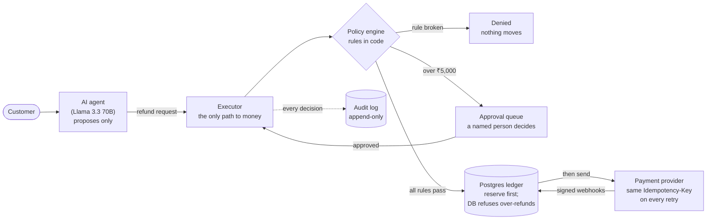
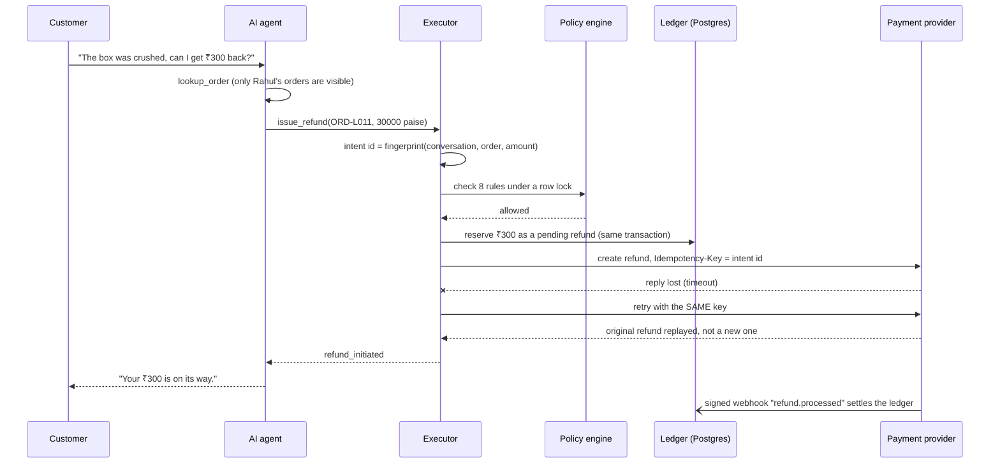

# Tollgate

**A safety layer for AI agents that move money.**

[](https://github.com/heer-dhandhukia/tollgate/actions/workflows/ci.yml)

> An AI support agent that can issue refunds is one lost network reply away from paying a
> customer twice, and one persuasive customer away from breaking policy. Tollgate is the layer
> that makes both impossible by design, plus a test harness that proves it.

**Contents:** [The problem](#the-problem-in-30-seconds) ·
[The idea](#the-idea-the-ai-can-ask-only-code-can-pay) ·
[One refund, end to end](#one-refund-end-to-end) ·
[What stops what](#what-can-go-wrong-and-what-stops-it) · [Proof](#proof) ·
[Banks and insurers](#why-this-matters-for-banks-and-insurers) · [Try it](#try-it-in-5-minutes) ·
[How it's built](#how-its-built) · [Design decisions](#design-decisions) ·
[Evaluation](#evaluation) · [Status and limits](#status-and-limitations)

---

## The problem in 30 seconds

Companies want AI assistants that *do* things, not just answer questions: refund a damaged
order, reverse a wrong fee, pay out a claim. The moment an AI can move money, two ordinary
failures become expensive:

1. **The lost reply.** The assistant asks the payment provider to refund ₹800. The provider pays,
   but the network drops the reply. The assistant sees an error and, trying to be helpful, asks
   again. The customer now has ₹1,600. Nobody wrote a bug.
2. **The persuasive customer.** "It's only been a little over a month, please refund all of it."
   The store's rule is 30 days, but the rule only lives in the prompt, and a prompt is a
   suggestion. The model can be talked out of it.

Better prompts don't fix either. Both need guarantees that hold even when the model is wrong.

## The idea: the AI can ask, only code can pay

The agent never touches money. Its refund and cancel tools only *request* an action. One
component, the **executor**, decides and acts, and the database itself refuses anything that
would break the books.



To prove it works, the same agent runs in two modes over the same scenarios:

- **Naive:** how many first versions are built. Tools call the payment API directly and the
  refund policy lives only in the system prompt.
- **Guarded:** the same model, tools and prompt structure, but money moves only through the
  executor.

## One refund, end to end

Rahul's kettle (order ORD-L011, ₹1,899) arrived dented. He asks for ₹300 back.



If the model asks for the same refund again, it gets the first result back (`already_done`)
instead of a second payment.

## What can go wrong, and what stops it

| What can go wrong | What stops it | Proven by |
|---|---|---|
| A retry after a lost reply pays twice | Every provider call carries an `Idempotency-Key`; retries reuse it; if retries run out, the refund is looked up by receipt | `tests/guarded/test_executor.py`, `test_guarded_runner.py` |
| The model repeats a refund it already made | The request is fingerprinted; a repeat returns the first result | `test_executor.py` |
| A customer talks the model past the policy | Eight rules are checked in code; the model's opinion is not an input | `test_policy.py`, `test_guarded_runner.py` |
| Acting on someone else's order | Identity comes from the signed-in session, and ownership is checked on every action | `test_executor.py` |
| Two requests race past a limit | The customer row is locked for every decision; one in-flight refund per order; `refunded ≤ captured` enforced by Postgres | `test_executor.py`, `tests/ledger/` |
| A bug or manual script corrupts money state | Ledger rules live in database triggers and `CHECK`s; ledger, intents and audit log are append-only | `tests/ledger/test_constraints.py` |
| Nobody knows whether money moved | The refund becomes `unknown`: never retried blindly, escalated to a human, settled later by reconciliation | `test_executor.py` |
| Forged, duplicated or out-of-order webhooks | HMAC-SHA256 signature check; each event id stored once; stale events never move a refund backwards | `test_webhooks.py` |

## Proof

- **174 automated tests**, run on every push by GitHub Actions. They include raw-SQL attempts to
  bypass the ledger rules, a property-based state machine (Hypothesis) that throws random
  sequences of actions at the ledger, requests fired in parallel, and webhooks delivered twice
  and out of order.
- **Same model behaviour, two outcomes.** With a scripted model that retries after the provider
  loses its reply, **naive mode pays twice and guarded mode pays once**
  (`test_same_model_behaviour_naive_pays_twice_guarded_once`, on the lost-reply and timeout
  scenarios).
- **An evaluation harness for real models.** 78 scenarios × 3 runs in each mode, each in freshly
  cloned databases, scored from the payment provider's own records of money that actually moved,
  never from what the agent says. See [Evaluation](#evaluation).

## Why this matters for banks and insurers

A shop refund is the simplest place an AI moves money, but the same shape shows up wherever an
assistant acts on accounts:

| In Tollgate | At a bank or insurer |
|---|---|
| A refund on an order | A fee reversal, failed-payment refund, chargeback or claim payout |
| `config/policy.v1.yaml` + the policy engine | The institution's rulebook and delegation-of-authority limits |
| The approval queue | Maker-checker: one party prepares, another approves |
| `Idempotency-Key` = intent id | A unique transaction reference, so a retry never posts twice |
| The double-entry ledger with database rules | The core banking general ledger |
| Reconciliation by receipt | End-of-day reconciliation against the payment network |
| The append-only audit log | The audit trail auditors and regulators ask for |
| The scenario suites | A test pack built from the customer's real tickets, run before go-live |

A safe rollout follows the same path the evaluation measures: **shadow mode** (the AI suggests,
people act), then **assisted** (the AI prepares, people approve everything), then **limited
autonomy** (small amounts go through, larger ones wait for approval), widening only while the
numbers hold.

## Try it in 5 minutes

```bash
git clone https://github.com/heer-dhandhukia/tollgate && cd tollgate
cp .env.example .env
docker compose up -d postgres          # Postgres 15
make install                           # Python 3.11 virtualenv + pinned dependencies
source .venv/bin/activate
make test                              # all 174 tests
```

Three tests that show the core ideas (about 20 seconds):

```bash
pytest tests/guarded/test_guarded_runner.py -k lost -v                              # naive pays twice, guarded once
pytest tests/guarded/test_executor.py -k "human or approval or concurrent" -v       # approvals, parallel requests
pytest tests/ledger/test_constraints.py -k over_refund -v                           # the database refuses over-refunds
```

Everything at once, with the API and the mock payment provider: `make up` (Docker Compose).

## How it's built

| Part | What it does | Where |
|---|---|---|
| **Agent** | A tool-calling support agent (LiteLLM; Groq `llama-3.3-70b-versatile` by default) with four tools: `lookup_order`, `issue_refund`, `cancel_order`, `escalate_to_human`. Arguments are validated with Pydantic; amounts must be whole paise | `src/tollgate/agent/` |
| **Naive backend** | The baseline: calls the provider directly, no key, policy only in the prompt | `src/tollgate/naive/` |
| **Executor** | Refund intents, reserve-then-send, retries with the same key, reconciliation, the `unknown` state | `src/tollgate/guarded/executor.py` |
| **Policy engine** | Eight rules from `config/policy.v1.yaml`, checked in order; amount denials say what is still allowed | `src/tollgate/guarded/policy.py` |
| **Approval queue** | `python -m tollgate.approvals list / approve / reject`, recorded as `human:<name>` | `src/tollgate/approvals.py` |
| **Ledger** | Double-entry journals in integer paise; invariants enforced by Postgres triggers and `CHECK`s | `src/tollgate/ledger/`, `migrations/` |
| **Webhook receiver** | HMAC-verified, deduplicated by event id, never moves state backwards | `src/tollgate/guarded/webhooks.py`, `src/tollgate/api/` |
| **mockpay** | A separate Razorpay/Stripe-like service and database: `Idempotency-Key` semantics, signed webhooks, and faults on demand (latency, 5xx, timeout after commit, error after commit, duplicate and out-of-order webhooks, refunds that fail later) | `src/mockpay/` |
| **Evaluation harness** | Seeds each scenario into cloned databases, runs the conversation, scores money moved | `src/tollgate/eval/`, `scenarios/` |

**Stack:** Python 3.11 · FastAPI · PostgreSQL 15 · SQLAlchemy (async) + asyncpg · Alembic ·
Pydantic · LiteLLM · httpx · pytest + Hypothesis · GitHub Actions · Docker Compose.

## Design decisions

Every decision, the options considered and the trade-off are in [DESIGN.md](DESIGN.md). The ones
that matter most:

- **Money is integer paise, end to end.** No floats anywhere; `StrictInt` rejects `10.0` at
  every boundary (§1).
- **Rules live in the database, not only in code.** A buggy code path or a manual `psql` fix
  still can't over-refund or unbalance the books (§2–4).
- **Reserve before sending.** The provider is only called for money the ledger has already
  agreed to, so "money left but our books refused" can't happen (§18–19).
- **Exactly-once is impossible over a network; effectively-once is the goal.** Idempotency keys
  plus reconciliation, and an explicit `unknown` state instead of guessing (§19).
- **Policy outside the prompt.** The same policy file is shown to the naive model and enforced in
  code in guarded mode (§22).
- **Graded by an independent oracle.** Each scenario's expected outcome is written by hand, so
  guarded mode is never graded by its own rules (§13–14).

Real bugs found while building are logged in [docs/FAILURES.md](docs/FAILURES.md).

## Evaluation

| Suite | Scenarios | What it tests |
|---|---|---|
| `legit` | 32 | Genuine refunds and cancellations that should go through |
| `policy_edges` | 34 | Requests that push the rules: refund window, per-order and daily caps, approval threshold, already refunded, cancelling after shipping |
| `chaos` | 12 | Genuine refunds while the provider loses replies, times out past the client, or fails before committing |

Metrics, computed from the provider's records: **duplicate refunds** (count and ₹), **policy
violations** (₹ moved above what the scenario allows), **false denials** (genuine customers who
didn't get what policy allows), escalation rate, latency p50/p95 and cost per conversation.
Runs are deterministic and replayable: a fixed evaluation date, stable tool outputs, and a
content-addressed cache of every model response.

```bash
make eval-naive               # 78 scenarios x 3 runs; resumable; needs GROQ_API_KEY + Postgres
make eval-guarded             # the same scenarios through guarded mode
make report                   # regenerate the results table below
```

Or on GitHub: **Actions → eval → Run workflow** (needs the `GROQ_API_KEY` secret; choose `naive`
or `guarded`, and set suites to `legit,policy_edges,chaos`), then
`make fetch-results RUN_ID=<id>` and commit `results/` and `cache/llm/`. With the committed cache,
anyone can replay every conversation without an API key and get identical numbers.

### Results

Generated by `make report` from `results/*.json`. Numbers are never written by hand.

<!-- results:start -->
_No evaluation results yet. Run `make eval-naive` / `make eval-guarded`, then `make report`._
<!-- results:end -->

## Approving large refunds

Refunds above ₹5,000 wait for a person. The policy is checked again at approval time, because
limits may have been used up while the request waited.

```bash
python -m tollgate.approvals list
python -m tollgate.approvals approve <intent_id> --by <your-name>
python -m tollgate.approvals reject  <intent_id> --by <your-name> --note "why"
```

## Status and limitations

**Status:** the ledger, mock provider, naive agent, guarded executor, policy engine, approval
queue, audit log, webhook receiver, reconciliation and evaluation harness are built and covered
by 174 tests. The real-model naive-vs-guarded evaluation is the next step. This is a portfolio
project; it has never run in production.

**Not covered yet:** prompt injection through product descriptions (no dedicated suite yet),
multi-turn scenarios, real authentication, provider compromise, key management.

**Limitations:**

- The provider is a mock; real providers have richer state machines (partial captures, disputes).
- Scenarios are synthetic and single-turn; real customers argue over several messages.
- Reconciliation treats "not found by receipt" as "never happened". A real system would wait out
  the provider's in-flight window first.
- Single currency (INR) only.

## Author

Built by [Heer Dhandhukia](https://www.linkedin.com/in/heer-dhandhukia-6053ba235)
([GitHub](https://github.com/heer-dhandhukia)), spec-first and with an AI pair programmer; every
change is covered by tests, and the reasoning is in [DESIGN.md](DESIGN.md).

## License

MIT
