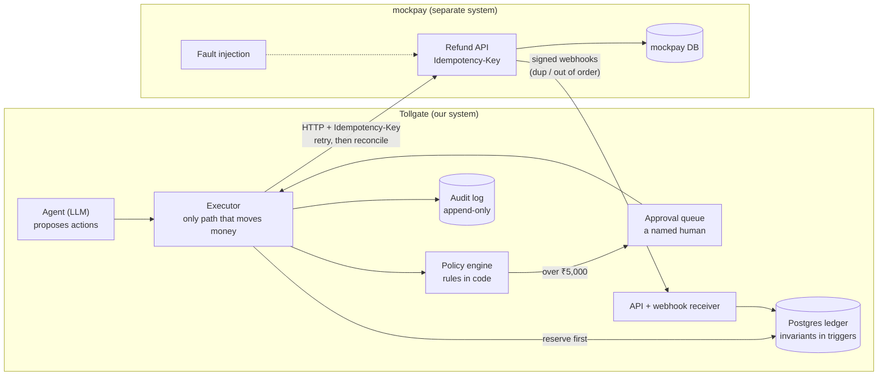

# Tollgate

**A safety layer for AI agents that move money.**

> What happens when an AI agent with money-moving tools retries, gets manipulated, or crashes
> mid-action, and what does it take to make that safe?

Tollgate is a customer-support agent that can issue refunds and cancel orders, plus the
machinery that makes it safe: a Postgres ledger whose invariants are enforced by the database,
an executor that is the only code path allowed to move money, a deterministic policy engine, a
human approval queue and an append-only audit log. It is evaluated by running the same scenarios
through a **naive** agent and a **guarded** one.

> Status: guarded mode built (executor, policy engine, approval queue, audit log, webhooks,
> reconciliation) and tested; the naive-vs-guarded evaluation is the next step.
> This is a portfolio project. It has never run in production.

## Architecture



## Quickstart

```bash
cp .env.example .env
make up            # postgres 15, migrations, mockpay on :8100, api on :8000
make test-docker   # full test suite inside compose
```

Without Docker: `make install` (Python 3.11+), point `TEST_PG_ADMIN_URL` at a Postgres 15 server,
then `make test`.

## Running the evaluation

```bash
make eval-naive               # 78 scenarios x 3 runs; resumable; needs GROQ_API_KEY + Postgres
make eval-guarded             # the same scenarios through guarded mode
make report                   # regenerate the results table below
```

Or on GitHub: **Actions → eval → Run workflow** (needs the `GROQ_API_KEY` secret; choose `naive`
or `guarded`, and set suites to `legit,policy_edges,chaos`), then `make fetch-results RUN_ID=<id>` and commit `results/` and `cache/llm/`. With
the committed cache, anyone can replay every conversation without an API key and get identical
numbers.

## Approving large refunds

Refunds above ₹5,000 wait for a person. The policy is checked again at approval time.

```bash
python -m tollgate.approvals list
python -m tollgate.approvals approve <intent_id> --by <your-name>
python -m tollgate.approvals reject  <intent_id> --by <your-name> --note "why"
```

## What's built

- **Ledger.** Customers, orders, payments, refunds and double-entry journals in integer paise.
  Refunded ≤ captured, balanced journals, append-only ledger and one-way status transitions are
  enforced by Postgres triggers and `CHECK`s, tested with raw-SQL bypass attempts and a
  hypothesis state machine.
- **Naive agent.** A tool-calling support agent (litellm, Groq `llama-3.3-70b-versatile` by
  default) whose refund/cancel tools call the provider directly, with policy only in the system
  prompt. This is the baseline. See DESIGN.md §12 for exactly what "naive" means.
- **Guarded agent.** The same agent, tools and validation, but refunds and cancellations go
  through the **executor**: every request becomes a refund intent fingerprinted by (conversation,
  order, amount); the **policy engine** checks `config/policy.v1.yaml` in code under a row lock;
  the ledger reserves the refund *before* the provider is called; provider calls carry an
  `Idempotency-Key` and are retried with the same key; when retries run out the refund is looked
  up by receipt (**reconciliation**); refunds over ₹5,000 wait in the **approval queue**. Every
  decision goes to an append-only **audit log**. See DESIGN.md §18–22.
- **Webhook receiver.** HMAC-verified, deduplicated by event id, and never moves a refund
  backwards when events arrive out of order.
- **Scenario harness.** 32 legit, 34 policy-edge and 12 chaos scenarios in YAML (chaos: genuine
  refunds while the provider loses replies, times out or fails), each run in its own cloned
  databases and scored from the provider's records of money actually moved.
- **mockpay.** A Razorpay/Stripe-like provider with `Idempotency-Key` semantics, signed webhooks
  and injectable faults: latency, 5xx, **timeout after commit**, error after commit, duplicate and
  out-of-order webhooks, and refunds that later fail.

## Results

Generated by `make report` from `results/*.json`. Numbers are never written by hand.

<!-- results:start -->
_No evaluation results yet. Run `make eval-naive` / `make eval-guarded`, then `make report`._
<!-- results:end -->

## Threat model

| Threat | What stops it | Tested in |
|---|---|---|
| A retry after a lost response pays twice | Idempotency-Key = intent id; retries reuse it; reconciliation by receipt | `tests/guarded/test_executor.py`, `test_guarded_runner.py` |
| The model repeats a refund it already made | Intent id is a fingerprint of the request; a repeat returns the first result | `test_executor.py` |
| A customer talks the model past the policy | The policy engine decides in code; the model's opinion is not an input | `test_policy.py`, `test_guarded_runner.py` |
| Acting on another customer's order | Identity comes from the session; ownership checked on every action | `test_executor.py` |
| Two requests race past a limit | Customer row lock for every decision; one in-flight intent per order (unique index); refunded ≤ captured in Postgres | `test_executor.py` |
| A bug or manual script corrupts money state | Ledger invariants and intent transitions enforced by triggers; ledger, intents and audit log are append-only | `tests/ledger/`, `test_executor.py` |
| Forged, duplicated or reordered webhooks | HMAC-SHA256 signature; event id stored once; stale events ignored | `test_webhooks.py` |

Not covered: prompt injection through product descriptions (no dedicated suite yet), real
authentication, provider compromise, key management, multi-turn social engineering.


## Limitations

- The provider is a mock; real providers have richer state machines (partial captures, disputes).
- Scenarios are synthetic and single-turn; real customers argue over several messages.
- Reconciliation treats "not found by receipt" as "never happened". A real system would wait out
  the provider's in-flight window first.
- Single currency (INR) only.

See [DESIGN.md](DESIGN.md) for decisions and trade-offs, and [docs/FAILURES.md](docs/FAILURES.md)
for bugs found along the way.

## License

MIT
